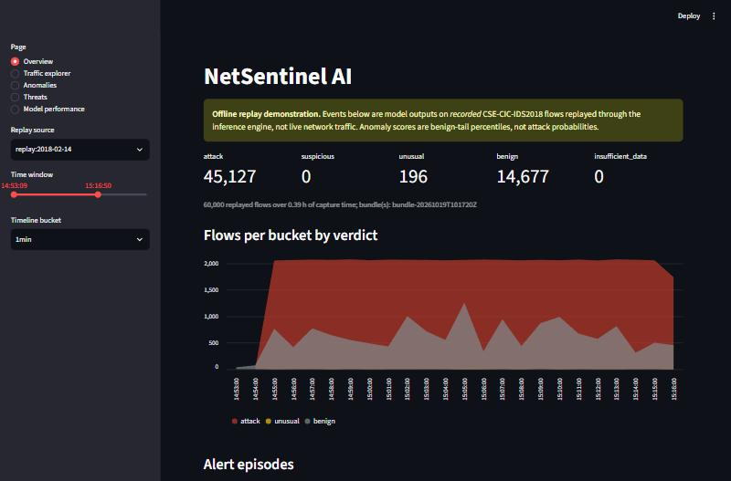
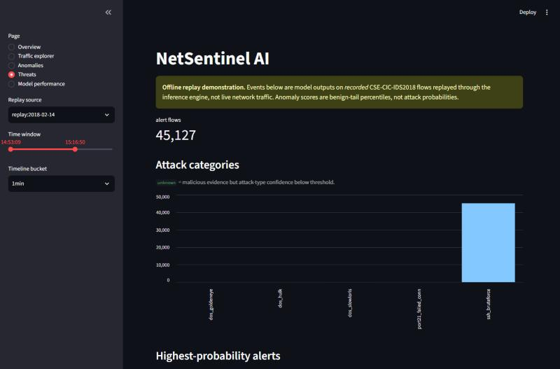

# NetSentinel AI

Leakage-aware machine learning for network-flow intrusion detection, validated on two
benchmarks (CSE-CIC-IDS2018 via CICFlowMeter and NetFlow v3, UNSW-NB15 via NetFlow v3), plus
an offline analysis application for PCAP / Zeek captures with a local API and dashboard.

The project's main contribution is **evaluation honesty** rather than a new model: measured
evidence of where near-perfect benchmark scores come from, what survives a leakage-aware and
independently audited protocol, and what does **not** transfer to another network.

> Status (2026-10-19): research prototype, detection only. In-domain scores are near-perfect
> and cross-network transfer fails; the shipped model is a **demonstration that must be
> retrained and calibrated on your own network**. See [Limitations](#limitations).

## Key findings (measured; validation splits unless marked "test")

Tables with run ids: [`results_v1`](reports/experiments/results_v1.md) (IDS2018 baselines),
[`results_v3`](reports/experiments/results_v3.md) (corrected open-set),
[`results_v4`](reports/experiments/results_v4.md) (NetFlow, transfer).
Discussion: [`report_v1.md`](docs/experiments/report_v1.md); audit:
[`validity_audit_2026-10-19.md`](docs/audit/validity_audit_2026-10-19.md).

| Finding | Evidence |
|---|---|
| **No cross-network transfer.** LightGBM trained on NF-IDS2018 scores ROC-AUC **0.24-0.44** on NF-UNSW-NB15 (identical nProbe features, 3 seeds; recall <= 0.01 even with a target-chosen threshold); the reverse direction flags 59-99.9 % of benign traffic at the source threshold | results_v4, report 3.9 |
| In-domain detection saturates on **both** datasets (PR-AUC 1.000, 5 seeds), even without TTL / window fields and with only 15 Zeek-compatible fields | results_v4 |
| **Within one network**, causal 5/30/300 s context detects *unseen* flood / brute-force / failed-connection groups at FPR 1e-3 (leak-free protocol, 5 seeds): e.g. DoS-HTTP 0.05 -> **0.95**, SSH brute force 0.60 -> **0.998**; it replicates with the nProbe extractor, but not for the botnet, nor for low-volume web/Slowloris attacks; single context statistics reproduce much of it | results_v3/v4, audit V2 |
| A **twin-class leak** inflated our first open-set results: FTP-BruteForce and DoS-SlowHTTPTest are identical traffic in different families (and ~30 mislabelled SSH flows share their vectors). Found by our audit, corrected, and still reported | audit V1 |
| The IDS2018 CSV timestamps use a **12-hour clock without AM/PM**; our correction is confirmed **to the second** by the independent epoch timestamps of NF-IDS2018 | dataset cards, `reports/audit/nf_vs_cic.json` |
| Test split (pre-registered, used once): LightGBM recall **0.983** [0.93, 1.00] at FPR 0.0009; removing 4 CICFlowMeter artefact fields drops it to **0.735** (HOIC 1.00 -> 0.07) | results_v1, test_v1 |
| Label-free anomaly detection (Isolation Forest, robust z) gives recall **0.000** at FPR 1e-3 for every unseen group and seed; a robust-z saturation defect was found and fixed, without improving detection | audit V5-V7 |
| A GRU over per-port flow sequences is marginally better than an MLP on seen attacks and far below LightGBM with explicit context on unseen groups | report 3.6-3.7 |

## Architecture

```
public CSVs --verify/ingest--> per-day Parquet --context + sample--> dataset
   --> split protocols + leakage checks --> training stages (ledger per run)
   --> model bundle (hash-checked) --> inference engine --> replay / API --> SQLite --> dashboard
```

Details: [`docs/architecture/overview.md`](docs/architecture/overview.md).

**What is implemented and tested**

* Data: ETag-verified download, streaming ingest (bounded memory), EDA, label-quality probes.
* Features: versioned schema; causal multi-scale context features (exact against brute force,
  no look-ahead test); causal per-port flow sequences.
* Splits: random, blocked, chronological, **episode-chronological** (default), leave-day-out;
  automated leakage checks on every run.
* Models: dummy, logistic regression, random forest, HistGB, LightGBM (binary, attack type,
  family); robust-z and Isolation Forest anomaly models (global / service-conditioned);
  leave-one-family-out evaluation; GRU / MLP temporal models (PyTorch, GPU, early stopping,
  checkpointing; trained and validated, not test-evaluated).
* Inference: one prediction contract that separates calibrated P(malicious), attack-type
  confidence with `unknown` abstention, a 0-100 anomaly score (benign-tail percentile, not a
  probability), verdicts `benign | unusual | suspicious | attack`, evidence derived from
  measured feature deviations, and model versions.
* Second dataset: NetFlow v3 ingestion (BagIt SHA-1, local time, label alignment), versioned
  NF feature schema incl. a 15-field "portable" set, transfer stage (source train/val ->
  target val, oracle threshold reported separately).
* Offline application: pure-Python PCAP/pcapng reader (Ethernet/VLAN/SLL/raw IP, IPv4/IPv6,
  bounds-checked), bidirectional flow assembler emitting NetFlow-v3-style records, Zeek
  `conn.log` reader (TSV/JSON); `netsentinel analyze <capture>`; `POST /analyze` (admin token,
  50 MB cap) and a dashboard upload page.
* Serving: offline replay in event-time order, SQLite event store with retention, FastAPI
  (`/health /ready /models /predict/* /events /metrics/summary /replay/* /analyze`), Streamlit
  dashboard.
* Engineering: uv lockfile, 70+ CPU tests (unit, ML, integration incl. the full
  capture -> verdict path on synthetic data), ruff, Dockerfile + docker-compose (non-root,
  read-only, localhost-only), GitHub Actions workflow with tests, Docker build/smoke test,
  dependency and secret scanning. **Docker and CI have not been executed**: Docker is not
  installed locally and the repository has no remote yet.

## Quick start

Requires Python 3.12 and [uv](https://docs.astral.sh/uv/). The tests need no data download.

```bash
uv sync
```

```bash
uv run pytest
```

Reproduce the data pipeline (6.9 GB download; verify + ingest + EDA + feature build took about
20 minutes on a 4-core / 8 GB machine, plus download time):

```bash
bash scripts/download_ids2018.sh
```

```bash
uv run netsentinel data verify
```

```bash
uv run netsentinel data ingest
```

```bash
uv run netsentinel data eda
```

```bash
uv run netsentinel features build
```

Run the experiment batch (about 25 minutes, peak about 2.7 GB RAM) and aggregate:

```bash
uv run python scripts/run_batch_v1.py
```

```bash
uv run python scripts/aggregate_results.py
```

Build a bundle from runs, replay a recorded window, serve and explore:

```bash
uv run netsentinel bundle build --threat-run runs/<threat_run> --anomaly-run runs/<anomaly_run> --type-run runs/<type_run>
```

```bash
uv run netsentinel replay --bundle models/<bundle-id> --path data/interim/ids2018/2018-02-14.parquet --start 2018-02-14T14:55:00 --end 2018-02-14T15:40:00
```

```bash
uv run netsentinel serve --bundle models/<bundle-id>
```

```bash
uv run --extra dashboard streamlit run dashboard/app.py
```

### API example

```bash
curl -s -X POST http://127.0.0.1:8000/predict/flow -H "content-type: application/json" -d "{\"timestamp\": \"2018-02-14T15:00:00\", \"dst_port\": 22, \"protocol\": 6, \"flow_duration\": 1000, \"features\": {\"tot_fwd_pkts\": 20, \"tot_bwd_pkts\": 2}}"
```

A single flow carries no traffic history, so context features are listed in
`missing_features`. Batch scoring with `compute_context=true` treats the batch as a stream.

### Offline capture analysis (PCAP / pcapng / Zeek conn.log)

NetFlow v3 data for the portable model (UQ, open access, 0.9 GB):

```bash
uv run python scripts/download_nf_v3.py
```

```bash
uv run netsentinel data ingest-nf nf-cicids2018-v3
```

```bash
uv run netsentinel features build --schema nf --interim data/interim/nf_cicids2018_v3 --out data/processed/nf_cicids2018_v3
```

Train the portable model and anomaly detector, then bundle them (commands in
`scripts/run_batch_v4.py`, items `N5_*`). Analyze a capture:

```bash
uv run netsentinel analyze capture.pcap --bundle models/<bundle-id> --utc-offset 0 --out summary.json
```

A synthetic demo capture: `uv run python scripts/make_demo_pcap.py artifacts/demo.pcap`. On it,
the IDS2018-trained portable model rates almost every flow *unusual*, flags 191 benign-looking
HTTPS flows *suspicious* and misses the generated SSH attempts (report 3.10): exactly the
cross-network failure measured in the transfer experiments. Retrain on your own network.

### Docker

```bash
docker compose up --build
```

Mounts a bundle from `NETSENTINEL_BUNDLE` read-only and publishes the API on 127.0.0.1:8000.
Not built locally (Docker unavailable on the development machine); the CI workflow builds and
smoke-tests the image once the repository is pushed.

## Dashboard (replay demonstration)

The screenshots are from the running application, replaying **recorded** IDS2018 flows from
2018-02-14 14:53-15:17, which lies mostly in the validation/test parts of the SSH brute-force
episode (the first minutes overlap the training part). This is a pipeline demonstration, not
an evaluation, and not live traffic.




## Evaluation protocol

* Thresholds are chosen on validation at a prevalence-weighted benign FPR of 1e-3.
* The test split is touched once per run, for runs pre-registered in
  [`docs/experiments/test_preregistration.md`](docs/experiments/test_preregistration.md).
* Metrics: PR-AUC, ROC-AUC, recall at fixed FPR, precision, ECE, macro and weighted F1,
  per-class recall, false-alert flows per hour, and block-bootstrap 95 % CIs on test.
* Every reported number traces to a `runs/<run id>/` directory (config, environment, git SHA,
  metrics, split indices, leakage report).

## Limitations

* **Measured: models do not transfer across networks.** Every deployment needs local
  training data and threshold calibration; the shipped bundle is a demonstration.
* Benchmarks with documented label errors (original labels used; the CIC and NetFlow releases
  of IDS2018 even disagree on web-attack labels).
* Per-host baselines and application identification were not evaluated: IDS2018 CSVs lack host
  ids; "service" is a port heuristic. (NF-v3 has nDPI L7 labels - an unexplored option.)
* The PCAP flow assembler approximates nProbe; field-level agreement is unverified. The
  application was exercised on synthetic captures only. No live capture; Zeek is supported as
  an input log, not run by NetSentinel; no Suricata integration.
* Docker and CI are written but unexecuted (no local Docker, no remote repository yet).
* Seed variance covers the main validation comparisons; the test evaluation (IDS2018 CIC only)
  and several secondary runs are single-seed. NetFlow test splits are untouched.
* The API has no TLS, accounts or rate limiting; it binds to localhost and is detection-only.
  See [`docs/security/threat_model.md`](docs/security/threat_model.md).

## Roadmap

1. Pre-register and run the final locked-test evaluation (NetFlow test splits untouched).
2. Incident-level false-alert evaluation for context models.
3. Target-network calibration / domain adaptation as an explicit experiment.
4. Validate the PCAP flow assembler against nProbe on paired captures.
5. Push to GitHub to execute CI (tests, Docker build, security scans).

## References

The literature review with verified sources is in
[`docs/research/literature_review.md`](docs/research/literature_review.md). Dataset:
Sharafaldin, Lashkari, Ghorbani, *Toward Generating a New Intrusion Detection Dataset and
Intrusion Traffic Characterization*, ICISSP 2018. Label errors: Liu, Engelen et al., IEEE CNS
2022, doi:10.1109/CNS56114.2022.9947235.

## License

MIT, see [LICENSE](LICENSE). Datasets keep their own terms: CSE-CIC-IDS2018 (UNB/CIC, cite
Sharafaldin et al. 2018); NetFlow v3 (UQ, re-use with commercial restriction, cite Luay et al.
2025, arXiv:2503.04404).
