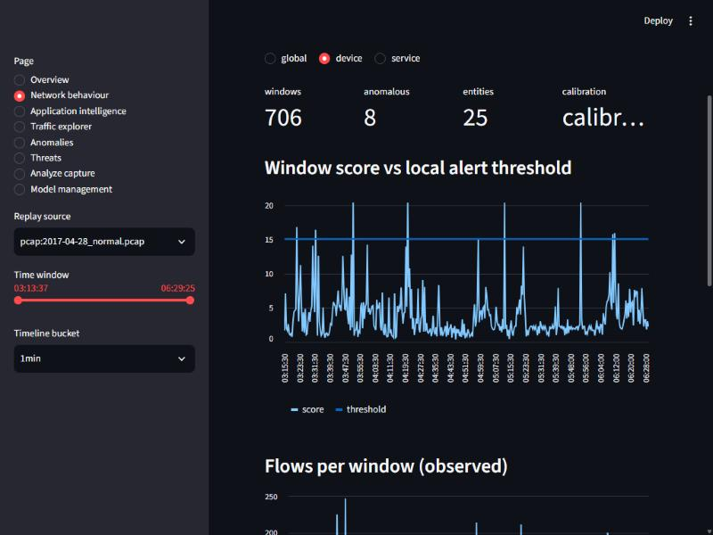
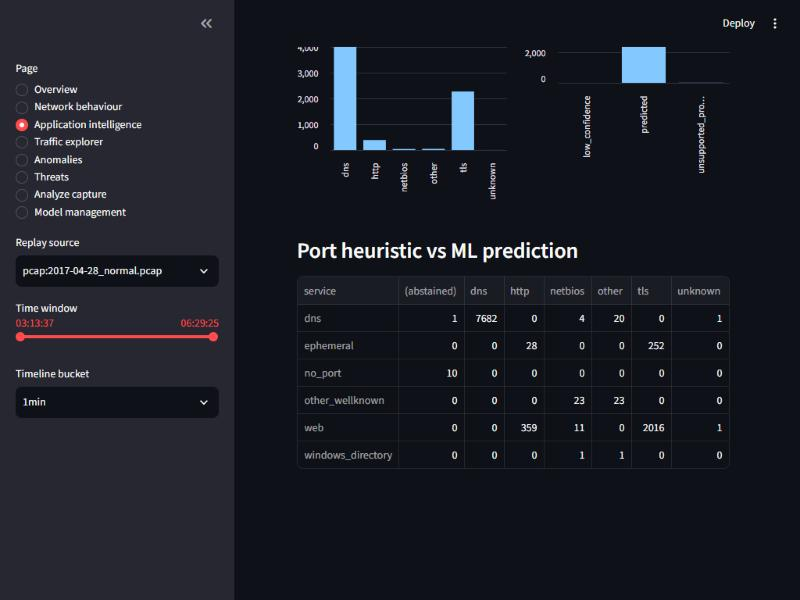

# NetSentinel AI

[](https://github.com/Apostal322/NetSentinel-AI/actions/workflows/ci.yml)

**Leakage-aware machine-learning research on network-flow intrusion detection, plus a local,
detection-only tool that learns a behavioural baseline from your own PCAP or Zeek data.**

The main contribution is *evaluation honesty*, not a new model. The repository measures:
- where near-perfect benchmark scores come from;
- what survives pre-registered, leakage-aware testing;
- what does not transfer to another network;
- what a local, calibrated baseline can and cannot do instead.

> **Status (v0.8.0, 2026-10-21): research prototype, detection only.** Offline analysis, plus
> an opt-in monitor that reads the Zeek log your own Zeek writes.
> - Supervised models score almost perfectly on the network they were trained on and fail on
>   other networks (pre-registered test).
> - The product path therefore treats them as *unverified* by default. It reports deviations
>   from a locally calibrated baseline and an abstaining protocol classifier, never
>   unsupported attack verdicts.
> - This is not a production IDS. Read [Limitations](#limitations) and the
>   [release-readiness audit](docs/RELEASE_READINESS.md).

## What is validated and what is research

| Capability | Status | Evidence |
|---|---|---|
| PCAP/pcapng and Zeek `conn.log` ingestion, flow assembly | **Validated**: matches Zeek on a real 199k-packet capture (TCP flow count equal, 99.8% packet/byte agreement) | `reports/audit/pcap_vs_zeek.json` |
| `netsentinel calibrate`: local behaviour baseline (global / device / service, causal 30 s windows) with diagnostics, provisional/insufficient-history states, review-before-activate and rollback | **Implemented and tested** (unit, integration, real CTU captures) | `docs/phase7/RELIABILITY.md` |
| Evidence-aware decisions: behaviour anomaly vs supervised evidence vs known attack; supervised verdicts unverified by default | **Implemented and tested** | `tests/unit/test_threat_policy.py` |
| Protocol identification: ML (nDPI proxy labels) + training-data port evidence, abstains on conflict | **Implemented**; validated on development data; descriptive check on real traffic | `docs/phase7/RELIABILITY.md` P3 |
| FastAPI service, SQLite event store, Streamlit dashboard | **Implemented and tested** (TestClient, real `serve` process, Streamlit AppTest, browser check; model-backed Docker smoke test in CI) | `tests/integration/`, `.github/workflows/ci.yml` |
| `netsentinel demo`: offline end-to-end walkthrough on synthetic traffic | **Implemented and tested** (about 1 min, no downloads) | `tests/integration/test_demo.py` |
| `netsentinel monitor --zeek-log`: opt-in streaming of a local Zeek log (event-time windows, lateness, deduplication, bounded memory) | **Validated**: identical to offline on 5.4M real records, including jittered and duplicated input (pre-registered H6) | `docs/phase8/CONFIRMATORY_RESULTS.md` |
| Incidents: per-entity grouping, stable IDs, severity, lifecycle, API and dashboard explorer | **Implemented and tested**; alert reduction 45x on a fresh capture, but 9 of 10 incidents there were isolated false alerts (pre-registered H3 refuted) | `docs/phase8/CONFIRMATORY_RESULTS.md` |
| Temporal models (EWMA, lag-IForest, GRU, TCN) | **Research, negative result**: none beat the robust baseline (development data, and pre-registered H1a/H1b) | `docs/phase8/DEVELOPMENT_LOG.md` |
| Supervised attack detection (LightGBM, CIC-IDS2018 / NetFlow v3) | **Research**: in-domain only | `docs/RESULTS.md` |
| Unknown-attack detection by anomaly models | **Research, negative result** | `docs/phase6/REPORT.md` |
| Explicit uncertainty states (Phase 8e): every prediction says whether "no alert" is a supported claim of normality or an uncertainty (insufficient or expired calibration, drift, degraded telemetry, unsupported network, no model) | **Implemented and tested**; evidence is never silenced by uncertainty, verdicts unchanged | [`docs/phase8e/UNCERTAINTY_STATES.md`](docs/phase8e/UNCERTAINTY_STATES.md) |
| Streaming timestamp security (Phase 8e/8f): quarantine of out-of-range records, verified clock jumps, a corroborated (median) clock, explicit health flags | **Tested** on 22 adversarial scenarios, including near the 90% trigger and in-skew forgery (0 genuine records lost), and on real ToN_IoT data | [`docs/phase8e/STREAMING_ROBUSTNESS.md`](docs/phase8e/STREAMING_ROBUSTNESS.md), [`docs/phase8f/STREAMING_8F.md`](docs/phase8f/STREAMING_8F.md) |
| Packet capture, blocking, multi-network deployment | **Not implemented** (by design) | — |

## Headline results

Full tables with sources and data roles: [`docs/RESULTS.md`](docs/RESULTS.md).

| Question | Answer |
|---|---|
| In-domain supervised detection | recall 0.983 (CIC test, once) and 1.000 (NetFlow test, both datasets) at FPR about 1e-3. Without 4 CICFlowMeter artefact fields: 0.735 |
| Does it transfer to another network? | **No.** ROC 0.37–0.66 IDS2018 <-> UNSW-NB15 on identical nProbe features; source thresholds flag 35–99% of benign flows (pre-registered) |
| Does a local baseline reduce false alerts on an unfamiliar benign network? | Yes: about 120 -> 2.3 false-alert windows/h (13 CTU captures). Its pre-registered FPR guarantee failed in 5/12 captures with Phase 6 thresholds; cross-fitted thresholds fixed that on the same data (exploratory) at a recall cost elsewhere |
| Does calibration restore attack detection? | **No.** With attack traffic in the calibration period, recall collapses (IoT-23, NetFlow development data) |
| Does the local baseline hold on a fresh capture? (Phase 8, pre-registered, IoT-23 49-1) | FPR 1.09% at a 1% target, recall 1.00 under vetted calibration; robust median/MAD beats the adaptive EWMA candidate (PR-AUC 0.93 vs 0.68). One capture: no generalisation claim |
| Does the local baseline detect attackers on fresh captures? (Phase 8b, pre-registered, IoT-23 1-1, 60-1, 9-1) | **Quiet but blind**: FPR 0-1.5% as promised, but 0 of 4 attacking devices detected at its operating threshold. A cross-capture supervised window model ranked better (replicated) and caught 4/4 at FPR 0-5.5%; GRU/TCN lost to robust statistics (3/3). [`docs/HYPOTHESIS_LEDGER.md`](docs/HYPOTHESIS_LEDGER.md) Root cause (Phase 8c): the single threshold was set by transient external sources scored against the pooled fallback, not a coding bug; calibration now warns when this happens ([`docs/phase8c/ROOT_CAUSE.md`](docs/phase8c/ROOT_CAUSE.md)) |
| External network (ToN_IoT, UNSW testbed; pre-registered, Phase 8c) | The deployed baseline **failed** its FPR promise (8.9% at 1%). A cross-network supervised window model (trained without UNSW data) ranked far better (PR-AUC 0.97 vs 0.70) and beyond the scan signature. One dataset, a 4-hour evaluation, IP-tagged labels: [`docs/phase8c/EXTERNAL_RESULTS.md`](docs/phase8c/EXTERNAL_RESULTS.md) |
| Can thresholds make detections reliable? (Phase 8d, development data) | No policy tested is both within the false-alert budget and sensitive. Only selective abstention (no decision where calibration is unreliable) kept the budget, covering 11 of 22 captures. Every LightGBM operating point broke it (up to 29% FPR), so it stays research-only: [`docs/phase8d/REPORT.md`](docs/phase8d/REPORT.md) |
| Can per-population false-alert budgets fix the alert burden? (Phase 8e, development data, pre-declared rule) | **No.** No policy kept every population within budget; overruns come from calibration-to-evaluation shift (39% realised FPR at a 1% target on one dataset), not from how thresholds are allocated. ToN_IoT labels mark 3 scanners plus 37 responders as "attack sources" (retrospective): [`docs/phase8e/REPORT.md`](docs/phase8e/REPORT.md) |
| Can drift detection or automatic recalibration make calibration reliable? (Phase 8f, development data, pre-declared rules) | **Not automatically.** False positives come mainly from transient sources scored by the pooled fallback, not from calibration age. A new block-permutation shift test separated unreliable periods (33x) but failed its pre-declared adoption criterion, so it ships only as `--validity-shadow`. Periodic or drift-triggered refits cut false alerts by learning the attacks (recall 0.27 -> 0.03-0.05). Only vetted refresh helped, and only with oracle vetting: [`docs/phase8f/REPORT.md`](docs/phase8f/REPORT.md) |
| Does the baseline find real bots on an independent network? (Phase 8g, pre-registered, CTU-13 scenario 9) | **Yes, at its operating point:** all 10 documented bots within about a minute of infection (window recall 0.21), and 0 false alerts on the 6 verified-benign hosts. The unlabelled background drew 2,563 alerts/h, mostly what a 1% target gives at about 197k device windows/h, so it is a triage burden, not a measured false-positive rate. The gated refresh absorbed 71% of the attack, because a few persistent bots dilute a population-level gate. A post-hoc audit found and fixed silent record loss in the stream; scenario 10 was not evaluable. [`docs/phase8g/FINAL_REPORT.md`](docs/phase8g/FINAL_REPORT.md) |
| Can representation, calibration or fusion fix cross-network failure? (Phase 8h, pre-registered, development data, exploratory) | **No, none of four remedies worked.** Per-network standardisation, a new invariance-based feature screening, block-bootstrap thresholds and score fusion all failed their pre-registered rules. Diagnosis (exploratory): LightGBM on raw window features ranks 5 of 5 held-out attack days *within* one network almost perfectly (recall ≈ 1.0 at a 1%-FPR threshold set on the target's labels), and reaches 0.03 on another network. Benign traffic identifies its network at ROC-AUC 0.9999. Removing volume features lifts cross-network ROC-AUC from 0.39 to 0.93, but not recall at 1% FPR: [`docs/phase8h/FINAL_RESEARCH_REPORT.md`](docs/phase8h/FINAL_RESEARCH_REPORT.md) |
| Can a few target labels, shift-aware abstention or a less network-identifying representation fix cross-network detection? (Phase 8i, pre-registered, one protected fresh network: NF-BoT-IoT-v3) | **No.** Every registered confirmatory test failed or was not evaluable. Twenty-five labelled target windows raised recall to 0.92, but at 9.8% FPR, and were not better than no labels at the 2.5th percentile. Removing network-identifying features did not help (on development data, network identity stayed detectable: ROC-AUC 0.98). The deployed detector raised no alerts on the fresh network, so abstention could not be tested. The binding constraint is calibration: every registered method overran the 1% budget (a non-selected variant reached 1.3% in exploratory analysis), and post-hoc the fresh network's benign evidence was essentially two sources, one of them an ordinary host (2.2 effective hosts): a final audit shows that calibration fails its own host-grouped check without using any evaluation scores. [`docs/phase8i/FINAL_REPORT.md`](docs/phase8i/FINAL_REPORT.md) |
| Can calibration reliability be predicted or protected? (Phases 8j-8k, development data, then a stopped confirmation) | **Not established.** Phase 8j: a registered development NO-GO; purging calibration-period attackers from the destination memory (P1x) became the deployable calibration protocol. Phase 8k: closed NOT EVALUABLE; one probed dataset was dropped, the other was ambiguous, and the user stopped before any confirmation data were opened. [`docs/phase8j/`](docs/phase8j/), [`docs/phase8k/`](docs/phase8k/README.md) |
| Does a 1% threshold hold its budget on an unseen network? (Phase 8l, pre-registered, DEDALE, one run) | **Yes, n = 1:** verified-benign FPR 0.55% [0.49, 0.62]% over two weeks (26 hosts). Detection at that threshold is poor (window recall 7%, about 151 false alerts per working day), and a power analysis shows public data cannot support a network-level confirmation (15-30 eligible networks needed, 0-1 exist). [`docs/phase8l/`](docs/phase8l/README.md) |
| Can an adaptive destination memory replace the frozen novelty feature? (Phase 8m, pre-registered, development data) | **No (development NO-GO).** A guarded memory never absorbs a single-host beacon but accepts only 5.5% of benign new destinations, while destinations contacted by several attackers are accepted within an hour; the candidate lost recall on 4 of 4 networks. The frozen novelty is associated with most DEDALE false alerts (post-hoc). [`docs/phase8m/FINAL_RESEARCH_REPORT.md`](docs/phase8m/FINAL_RESEARCH_REPORT.md) |
| Why does the detector collapse when it is refitted, and can training make it robust? (Phase 8n, pre-registered, development data) | **Explained, and partly fixed (development only).** A 23-arm factorial (about 600 model × domain runs, every reference fit bit-identical to the historical baseline) traced the collapse to the information in `new_dst_frac` and to whole-attacker flips on single-attacker days when the training data change. A 5-member seed ensemble removed those flips in a fresh-randomness replication (unstable attack entities 11 → 1), with mixed recall elsewhere (NF-ToN −0.02, NF-BoT −0.03). No independent network exists to confirm it; the deployed detector is unchanged. [`docs/phase8n/FINAL_RESEARCH_REPORT.md`](docs/phase8n/FINAL_RESEARCH_REPORT.md) |
| Do training and scoring use the same feature semantics, can the ensemble be smaller, and can calibration be fixed? (Phase 8o, pre-registered, development data) | **No improvement (development NO-GO).** Training rows mix an expanding and a frozen destination memory, and the mix is confounded with the label. A causal partial alignment had no detectable effect, and removing the frozen-novelty association collapsed NF-CIC ranking to chance, so the NF-CIC detection rests on a dataset-specific shortcut. The 5-model ensemble's stability gain over single models reproduced (unstable attackers 13–24 → 5); no smaller ensemble met the rule. False-alert excess has a different cause on each network, no simple calibration fixes it, and without confirmed calibration labels detection collapses. Frozen M2 and the deployed detector are unchanged. [`docs/phase8o/FINAL_RESEARCH_REPORT.md`](docs/phase8o/FINAL_RESEARCH_REPORT.md) |
| Can victim-side, service-aware or bidirectional representations recover the attacks the detector misses? (Phase 8p, pre-registered, development data) | **No (development NO-GO), and most "misses" were not attacks.** A label audit against the official CSE-CIC-IDS2018 table found that 19 of the 20 never-detected entities are undocumented sources (label artifacts); the documented web attacker is detected; the 02-20 LOIC "miss" is the onset of the documented LOIC-UDP attack under the HTTP label. New victim-window, victim-context and service features (with causality tests) improved oracle ranking on 3 of 4 networks but no candidate improved operational detection under the shared 1% budget: victim context encodes shared-infrastructure fan-in and collapsed NF-CIC (0.81 → 0.18); late fusion multiplied NF-BoT false alerts by 5.8. Without confirmed calibration labels detection collapses; host-balanced calibration restores NF-ToN only at 34% FPR. Frozen M2 and the deployed detector are unchanged. [`docs/phase8p/FINAL_RESEARCH_REPORT.md`](docs/phase8p/FINAL_RESEARCH_REPORT.md) |
| Is the benchmark's ground truth sound, and can the detector be calibrated without knowing which calibration hosts attacked? (Phase 8q, pre-registered, development data) | **Benchmark audited; label-free calibration not achieved.** A versioned audit against the official attack schedules separates 48 documented attackers, 5 attacked hosts and 22 undocumented sources (frozen M2: 0.79 historical vs 0.90 documented-attacker recall, same detector). The calibration-label dependency is about two thirds threshold contamination (NF-ToN/NF-BoT calibration periods are 76-92% attack windows) and one third contamination of the frozen destination memory (NF-CIC 02-22, 03-02). None of four registered label-free threshold estimators recovered it. No model trained; deployment unchanged. [`docs/phase8q/FINAL_RESEARCH_REPORT.md`](docs/phase8q/FINAL_RESEARCH_REPORT.md) |
| Can a small trusted (vetted) sample replace oracle calibration labels? (Phases 8r-8s, pre-registered, development data, simulated review) | **Not at the registered budgets.** Without trusted data the threshold is not identifiable. Random host vetting (8r) misses the window mass (NF-ToN FPR 69%). Window-proportional review with Hajek weighting (8s) fixes representativeness on NF-CIC and NF-ToN, but at 30 reviews NF-ToN still exceeds its false-alert limit (20% vs 18%). Realistic reviewer errors contaminate the trusted set, and in the evaluation period a correctly calibrated 1% threshold detects almost nothing on NF-ToN and NF-UNSW. No model trained; deployment unchanged. [`docs/phase8s/FINAL_RESEARCH_REPORT.md`](docs/phase8s/FINAL_RESEARCH_REPORT.md) |
| Can host- or service-conditional (hierarchical) thresholds detect more at the same 1% false-alert budget? (Phase 8t, pre-registered, development data) | **No; the scorer is the limit.** At a true 1% FPR the frozen M2 detects 0.5% to 57% of documented attack windows per network (macro 0.275). A retrospective service-profile oracle reaches 0.491 by placing alerts where it knows attacks are; deployable hierarchical and per-host thresholds reach 0.270 and 0.241. Further threshold work stops; the next step is the scoring model. [`docs/phase8t/FINAL_RESEARCH_REPORT.md`](docs/phase8t/FINAL_RESEARCH_REPORT.md) |
| ML protocol ID vs port lookup | Better in-dataset (macro-F1 0.945 vs 0.840). Confidently wrong under shift (HTTP on port 80 called TLS), so the product combines it with port evidence and abstains on conflicts |

## Quick start

Requires Python 3.12 and [uv](https://docs.astral.sh/uv/). Tests need no data download.

```bash
uv sync --extra dashboard
```

```bash
uv run --extra dashboard pytest
```

The fastest way to see everything work is a one-command offline demo. It generates traffic,
trains a small model, calibrates, analyses an injected SSH brute force and port scan, and
writes events and incidents. It is a software demo on synthetic traffic, not evidence of
detection quality:

```bash
uv run netsentinel demo --workspace artifacts/demo
```

```bash
uv run --extra dashboard streamlit run dashboard/app.py -- --events-db artifacts/demo/events.sqlite --models-dir artifacts/demo/models
```

The steps one by one:

```bash
uv run python scripts/make_demo_pcap.py artifacts/demo.pcap
```

```bash
uv run netsentinel calibrate artifacts/demo.pcap --mode vetted_benign --assert-benign --window 5 --out models/calibrations --activate
```

Analysis needs a supervised model bundle. Bundles are not shipped: build one with
`netsentinel bundle build` after the NetFlow pipeline below.

```bash
uv run netsentinel analyze artifacts/demo.pcap --bundle models/<bundle-id> --calibration active --events-db artifacts/events.sqlite --out summary.json
```

```bash
uv run --extra dashboard streamlit run dashboard/app.py -- --events-db artifacts/events.sqlite
```

### Using it on your own capture

Only analyse traffic you are authorised to analyse.

1. **Calibrate** on a period you believe to be normal. `--assert-benign` records that
   assertion; without it, use `--mode unlabelled` and treat the baseline with suspicion.
   Calibrate with `--until <time>`, then analyse a later period with `--since <time>`.
2. **Update safely.** `calibrate --previous active --activate` refuses to activate a new
   baseline whose period looks anomalous under the current one (possible attack traffic)
   until you pass `netsentinel calibration activate <id> --reviewed`.
   `netsentinel calibration rollback` restores the previous baseline.
3. **Read the outputs.**
   - `behavior.anomaly_score` is a percentile among held-out calibration windows, *not* a
     probability.
   - `threat_status` is `unverified_domain` unless you pass `--threat-policy trust` (you assert
     the network matches the model's training data), or use `auto` with a calibration whose
     domain check v2 passed.
   - `application.app_protocol` comes with `app_method` and `app_evidence`.
     `application_identity` is never inferred.
   - `assessment.state` says what a quiet result means. Only `normal_valid_baseline`
     (`normality_supported: true`) is a claim of normality. Check `normality_supported_share`
     and `telemetry_health` in the summary before reading the absence of alerts as "clean".

4. **Monitor continuously (opt-in).** If you run Zeek yourself, NetSentinel can follow its
   `conn.log`. It only reads the file; it never captures, scans or blocks:

   ```bash
   uv run netsentinel monitor --zeek-log /path/to/zeek/conn.log --follow --calibration active --events-db artifacts/events.sqlite
   ```

   `--lateness` (default 360 s) must exceed Zeek's inactivity timeouts: Zeek logs a
   connection only after it times out. Late records are counted, never silently merged.
5. **Triage incidents.** Anomalous windows of the same device or service, separated by less
   than 5 minutes, form one incident with a stable ID. Set its status (investigating,
   acknowledged, resolved, ...) in the dashboard's Incident explorer or with
   `POST /incidents/{id}/status`.

The API (`netsentinel serve`, localhost only) and the dashboard expose the same fields.




## Architecture

The research pipeline (datasets -> features -> leakage-checked splits -> training ->
pre-registered tests) is separate from the product path (capture -> flows -> calibration ->
evidence-aware analysis -> store -> API/dashboard). Details:
[`docs/architecture/overview.md`](docs/architecture/overview.md).

```
capture (PCAP / Zeek) -> flows -> causal windows -> local baseline (calibrate, registry)
                                        |
supervised bundle (policy-gated) -------+--> evidence-aware Prediction -> SQLite -> API / dashboard
protocol classifier (ML + port) --------+
```

## Research methodology

- **Leakage control.**
  - Causal features: a flow counts at its end time.
  - Episode-chronological splits with purge gaps.
  - Preprocessing fit on train only.
  - Automated leakage checks on every run.
  - Group/time-aware splits, saved split indices.
- **Pre-registration.** Both test sets were evaluated once, after written protocols:
  [`test_preregistration.md`](docs/experiments/test_preregistration.md) and
  [`final_preregistration_nf.md`](docs/experiments/final_preregistration_nf.md), the latter
  with a documented deviation. They are now spent; later phases use development or
  independent data and label each result confirmatory or exploratory.
- **Negative results are reported.** Several examples:
  - a twin-class leak that inflated early open-set results;
  - anomaly detectors that detect nothing at operational FPR;
  - autoencoder "success" driven by TTL artefacts;
  - failed pre-registered hypotheses (Phase 6 H1, H5, H7).
- **Audits.**
  - [`docs/audit/validity_audit_2026-10-19.md`](docs/audit/validity_audit_2026-10-19.md)
  - [`docs/FINAL_AUDIT.md`](docs/FINAL_AUDIT.md)
  - [`docs/phase6/FINAL_AUDIT.md`](docs/phase6/FINAL_AUDIT.md)
  - [`docs/RELEASE_READINESS.md`](docs/RELEASE_READINESS.md)

Reports by phase:
- [`report_v1.md`](docs/experiments/report_v1.md) (1–4);
- [`report_phase5.md`](docs/experiments/report_phase5.md) (transfer, adaptation, final test,
  PCAP/Zeek validation);
- [`docs/phase6/REPORT.md`](docs/phase6/REPORT.md) (local baselines, application ID);
- [`docs/phase7/RELIABILITY.md`](docs/phase7/RELIABILITY.md) (safe defaults, calibration
  reliability, protocol policy).

## Reproducing the research

Data provenance, licences and hashes: [`docs/datasets/README.md`](docs/datasets/README.md).
Downloads go to the git-ignored `data/` folder.

```bash
bash scripts/download_ids2018.sh
```

```bash
uv run netsentinel data verify
```

```bash
uv run python scripts/download_nf_v3.py
```

```bash
uv run netsentinel data ingest-nf nf-cicids2018-v3
```

```bash
uv run netsentinel features build --schema nf --interim data/interim/nf_cicids2018_v3 --out data/processed/nf_cicids2018_v3
```

Experiment batches are `scripts/run_batch_v{1..5}.py` and `scripts/phase6/*`,
`scripts/phase7/*`. Each run writes its config, git SHA, package versions, metrics and split
indices under `runs/`. Development machine: 4-core CPU, 8 GB RAM, GTX 1050 Ti. Runtimes and
peak memory are recorded in the development logs.

## Limitations

- **No cross-network generalisation** of the supervised models. Without local labels, no
  configuration tested is both quiet and able to detect attacks.
- Calibration controls false alarms only. It assumes the calibration period is benign, and
  persistent malicious behaviour in that period is learned as normal.
- Cross-fitted thresholds (default) trade recall for reliable FPR; split thresholds remain
  available.
- Protocol labels are nDPI proxy labels (nDPI version of the training data undocumented). On
  standard ports the policy is mostly a port lookup confirmed by the ML.
- Zeek logs a connection only when it ends: long-lived C&C appears hours late.
- Recalibrate only on traffic you have vetted. Phase 8f: refreshing a baseline from unvetted
  traffic learns attacks, and the update gate cannot catch sustained low-signal attacks.
- `normal_valid_baseline` means the validated conditions hold, not that traffic is benign.
  The 24 h calibration-expiry and 1% parse-error limits are pre-declared defaults, not
  validated ones.
- Incidents turn each isolated false alert into its own incident. On the fresh Phase 8
  capture, 9 of 10 incidents were benign-only (2.5/h): rank by duration as well as severity.
- The calibration update gate catches short bursts only partly (8 of 12 injected 60 s scans,
  development data). It flags persistently anomalous entities for review (Phase 8g), but a
  gradually starting attack can still pass and be learned.
- Streaming drops records that arrive after their window closed (the lateness policy). They
  are counted (`late`, `late_windows`) and, since Phase 8i, mark telemetry health
  `late_records`, so normality is not claimed. Assessments already emitted for those windows
  are not rewritten. Dense traffic spills to disk, at about a tenth of in-memory speed.
- Temporal models (EWMA, GRU, TCN, lag-IForest) are research code; none beat the robust
  baseline.
- Phase 8h results come from development data inspected in earlier phases: exploratory, not
  confirmatory. Within-network attack-family transfer does not imply cross-network transfer.
- Phase 8i has one fresh confirmatory network (NF-BoT-IoT-v3). It shares an institution with
  UNSW-NB15 and ToN_IoT, has 16 hosts, and is 99.7% attack traffic, so its false-alert
  estimates rest on very few benign hosts.
- The PCAP extractor matches Zeek, but its field-level agreement with nProbe is unverified.
- Benchmark labels contain documented errors; the test partitions are spent; the CIC test is
  single-seed.
- The dashboard runs Pillow 13 although Streamlit 1.66 declares `pillow<13`: an accepted,
  tested, temporary exception for security fixes, not upstream-supported compatibility
  ([`docs/security/DEPENDENCY_EXCEPTIONS.md`](docs/security/DEPENDENCY_EXCEPTIONS.md)).
- The API has no TLS, accounts or rate limiting (localhost only). Threat model:
  [`docs/security/threat_model.md`](docs/security/threat_model.md).
- Docker is verified only in CI (image build + health smoke test without a bundle); see the
  [release-readiness audit](docs/RELEASE_READINESS.md).

## Repository layout

```
src/netsentinel/   telemetry/ behavior/ appintel/ inference/ api/ storage/   (product path)
                   data/ features/ training/ models/ evaluation/ temporal/      (research)
dashboard/         Streamlit app
scripts/           batches, audits, phase6/, phase7/, release/
configs/           dataset and experiment configs
reports/           measured results (JSON/Markdown/figures) referenced by the docs
docs/              reports, audits, dataset cards, architecture, security
tests/             unit / integration / ml  (gpu, slow, data tests excluded by default)
```

## License and citation

Code: MIT, see [LICENSE](LICENSE). Datasets keep their own terms:
- CSE-CIC-IDS2018: cite Sharafaldin, Lashkari, Ghorbani, ICISSP 2018.
- NetFlow v3 (UQ): re-use with commercial restriction; cite Luay et al. 2025,
  arXiv:2503.04404.
- CTU-Normal and IoT-23 (Stratosphere Lab): cite "Garcia, Sebastian. Malware Capture Facility
  Project, https://stratosphereips.org" and Garcia, Parmisano, Erquiaga 2020 (IoT-23).

Label-error literature: Liu, Engelen et al., IEEE CNS 2022, doi:10.1109/CNS56114.2022.9947235.
Literature review: [`docs/research/literature_review.md`](docs/research/literature_review.md).
