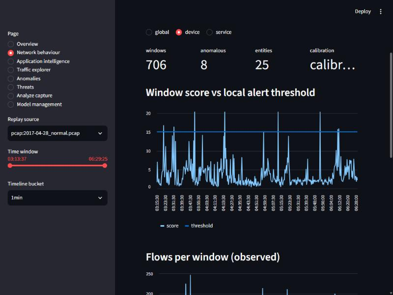
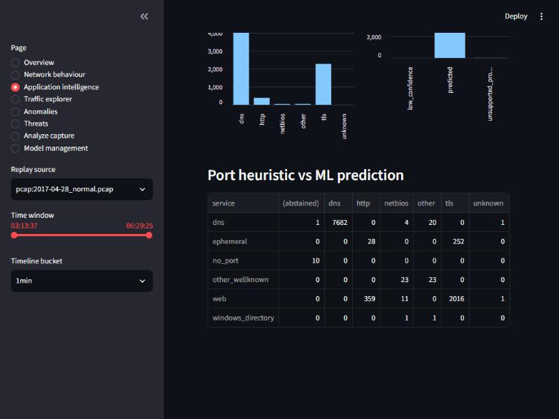

# NetSentinel AI

Leakage-aware machine learning for network-flow intrusion detection, validated on two
benchmarks (CSE-CIC-IDS2018 via CICFlowMeter and NetFlow v3, UNSW-NB15 via NetFlow v3), plus
an offline analysis application for PCAP / Zeek captures with a local API and dashboard.

The project's main contribution is **evaluation honesty** rather than a new model: measured
evidence of where near-perfect benchmark scores come from, what survives a leakage-aware and
independently audited protocol, and what does **not** transfer to another network.

> Status (2026-10-20, Phase 6): research prototype, detection only, offline-first.
> - **Phase 5** showed that a pretrained detector does not transfer between networks.
> - **Phase 6** adds a *local* workflow:
>   - `netsentinel calibrate` learns a behavioural baseline from authorised local traffic;
>   - an evidence-aware pipeline keeps "anomalous", "suspicious" and "known attack" apart;
>   - an abstaining ML protocol classifier is integrated.
> - On real benign traffic from an unfamiliar network, local calibration cut false alerts by
>   about 50x. Its FPR target was not reliably met, and calibration does **not** restore
>   attack detection.
> - See [Limitations](#limitations) and [`docs/phase6/FINAL_AUDIT.md`](docs/phase6/FINAL_AUDIT.md).

## Key findings (measured; validation splits unless marked "test")

Tables with run ids: [`results_v1`](reports/experiments/results_v1.md) (IDS2018 baselines),
[`results_v3`](reports/experiments/results_v3.md) (corrected open-set),
[`results_v4`](reports/experiments/results_v4.md) (NetFlow, transfer),
[`results_v5`](reports/experiments/results_v5.md) (adaptation, normal modelling),
[`results_final_nf`](reports/experiments/results_final_nf.md) (pre-registered NetFlow test).
Discussion: [`report_v1.md`](docs/experiments/report_v1.md) (phases 1-4) and
[`report_phase5.md`](docs/experiments/report_phase5.md) (adaptation, final test, real-traffic
validation, answers to the research questions); audit:
[`validity_audit_2026-10-19.md`](docs/audit/validity_audit_2026-10-19.md).

| Finding | Evidence |
|---|---|
| **Phase 6, local calibration on unfamiliar benign traffic** (13 CTU captures, calibrate on first half, evaluate second): median false-alert windows/h **2.3 vs 120** for the uncalibrated bundle. But FPR <= 3x target in only 7/12 captures, so the pre-registered H1 **fails**. On a real PCAP, flows marked unusual fall from 99.0% to 1.1% | `docs/phase6/REPORT.md` §2, §6 |
| **Phase 6, contamination:** unlabelled calibration with malicious traffic in the baseline period learns it as normal. Recall falls to about 0 (IoT-23; NF development data); H5 **fails** | REPORT §3–4 |
| **Phase 6, application classifier** (nDPI proxy labels): macro-F1 0.945 from Zeek/PCAP-common fields vs 0.84 port lookup (NF-IDS2018 validation); no host-stack shortcuts needed (H6). On independent real traffic (Zeek service as reference) accuracy is 0.925 vs a 0.999 port rule. HTTP is confidently misclassified, and abstention rarely triggers (H7 **fails**) | REPORT §5 |
| **Pre-registered final test (NetFlow v3, one-shot, 3 seeds).** In-domain LightGBM recall 1.000 at FPR 0.0006-0.0010 on both datasets. Transfer fails both ways: ROC 0.37-0.66, with source thresholds flagging 35-99% of benign flows. Label-free target calibration cuts false alerts from 29-66k to 23-183 flows/h but finds <= 0.5% of attacks. 5 of 6 hypotheses supported; the autoencoder-robustness hypothesis (H5) **failed**. A seed-dependent split phase is documented as a protocol deviation | report_phase5 §4, results_final_nf |
| **Why transfer fails:** the benign traffic of the two networks is separable with AUC about 1 (even on 5 fields); identically named nProbe fields have different semantics (active timeout, zero-duration flows, `*_SECOND_BYTES`); 8 features reverse their attack evidence between datasets | report_phase5 §1, `reports/audit/transfer.json` |
| **Benign-only normal models** (robust-z, Isolation Forest, autoencoder; flow / context views; 10k-50k calibration flows) reach recall 0 at FPR 1e-3 on both IDS2018 variants. On NF-UNSW the autoencoder's success comes from attacker TTL / minimum packet length and is seed-unstable | report_phase5 §3-4, `reports/audit/autoencoder_unsw.json` |
| **Calibration needs vetted benign data:** at true dataset contamination (9-17%), unlabelled calibration drops even in-domain recall from 1.00 to about 0.01 | results_v5 |
| **Real capture vs Zeek** (CTU-Normal-26, 199k packets): validation found and fixed a flow-assembler defect (the final ACK after FIN/RST opened a spurious flow, about 2,160 extra flows). Now TCP flow counts equal Zeek's, with packet/byte agreement on 99.8% of flows | report_phase5 §6, `reports/audit/pcap_vs_zeek.json` |
| **Application identification** (new): flow shape without ports predicts nDPI's protocol label with macro-F1 0.94 (NF-IDS2018) / 0.73 (NF-UNSW), vs port lookup 0.84 / 0.63 (validation; DPI label, not ground truth; no in-TLS claims) | report_phase5 §5 |
| **No cross-network transfer.** LightGBM trained on NF-IDS2018 scores ROC-AUC **0.24-0.44** on NF-UNSW-NB15 (identical nProbe features, 3 seeds; recall <= 0.01 even with a target-chosen threshold); the reverse direction flags 59-99.9 % of benign traffic at the source threshold | results_v4, report 3.9 |
| In-domain detection saturates on **both** datasets (PR-AUC 1.000, 5 seeds), even without TTL / window fields and with only 15 Zeek-compatible fields | results_v4 |
| **Within one network**, causal 5/30/300 s context detects *unseen* flood / brute-force / failed-connection groups at FPR 1e-3 (leak-free protocol, 5 seeds): e.g. DoS-HTTP 0.05 -> **0.95**, SSH brute force 0.60 -> **0.998**; it replicates with the nProbe extractor, but not for the botnet, nor for low-volume web/Slowloris attacks; single context statistics reproduce much of it | results_v3/v4, audit V2 |
| A **twin-class leak** inflated our first open-set results: FTP-BruteForce and DoS-SlowHTTPTest are identical traffic in different families (and ~30 mislabelled SSH flows share their vectors). Found by our audit, corrected, and still reported | audit V1 |
| The IDS2018 CSV timestamps use a **12-hour clock without AM/PM**; our correction is confirmed **to the second** by the independent epoch timestamps of NF-IDS2018 | dataset cards, `reports/audit/nf_vs_cic.json` |
| Test split (pre-registered, used once): LightGBM recall **0.983** [0.93, 1.00] at FPR 0.0009; removing 4 CICFlowMeter artefact fields drops it to **0.735** (HOIC 1.00 -> 0.07) | results_v1, test_v1 |
| Label-free anomaly detection (Isolation Forest, robust z) gives recall **0.000** at FPR 1e-3 for every unseen group and seed; a robust-z saturation defect was found and fixed, without improving detection | audit V5-V7 |
| A GRU over per-port flow sequences is marginally better than an MLP on seen attacks and far below LightGBM with explicit context on unseen groups | report 3.6-3.7 |

## Architecture

```
public CSVs --verify/ingest--> per-day Parquet --context + sample--> dataset
   --> split protocols + leakage checks --> training stages (ledger per run)
   --> model bundle (hash-checked) --> inference engine --> replay / API --> SQLite --> dashboard
```

Details: [`docs/architecture/overview.md`](docs/architecture/overview.md).

**What is implemented and tested**

* Data: ETag-verified download, streaming ingest (bounded memory), EDA, label-quality probes.
* Features: versioned schema; causal multi-scale context features (exact against brute force,
  no look-ahead test); causal per-port flow sequences.
* Splits: random, blocked, chronological, **episode-chronological** (default), leave-day-out;
  automated leakage checks on every run.
* Models: dummy, logistic regression, random forest, HistGB, LightGBM (binary, attack type,
  family); robust-z and Isolation Forest anomaly models (global / service-conditioned);
  leave-one-family-out evaluation; GRU / MLP temporal models (PyTorch, GPU, early stopping,
  checkpointing; trained and validated, not test-evaluated).
* Inference: one prediction contract that separates calibrated P(malicious), attack-type
  confidence with `unknown` abstention, a 0-100 anomaly score (benign-tail percentile, not a
  probability), verdicts `benign | unusual | suspicious | attack`, evidence derived from
  measured feature deviations, and model versions.
* Second dataset: NetFlow v3 ingestion (BagIt SHA-1, local time, label alignment), versioned
  NF feature schema incl. a 15-field "portable" set, transfer stage (source train/val ->
  target val, oracle threshold reported separately).
* Phase 5: label-free adaptation stage (`train adapt`: target threshold calibration, robust
  per-domain normalisation, shift-robust feature subset, target-benign robust-z / Isolation
  Forest / autoencoder; calibration-size and contamination sweeps; one-shot `final_test` mode
  with block-bootstrap CIs); application identification stage (`train appid`); transfer,
  autoencoder, test-overlap and PCAP-vs-Zeek audit scripts in `scripts/audit/`.
* Offline application: pure-Python PCAP/pcapng reader (Ethernet/VLAN/SLL/raw IP, IPv4/IPv6,
  bounds-checked), bidirectional flow assembler emitting NetFlow-v3-style records (TCP close
  linger and per-protocol timeouts, validated against Zeek on a real capture), Zeek
  `conn.log` reader (TSV/JSON); `netsentinel analyze <capture>`; `POST /analyze` (admin token,
  50 MB cap) and a dashboard upload page.
* Serving: offline replay in event-time order, SQLite event store with retention, FastAPI
  (`/health /ready /models /predict/* /events /metrics/summary /replay/* /analyze`), Streamlit
  dashboard.
* Engineering: uv lockfile, 92 default CPU tests (unit, ML, integration incl. the full
  capture -> verdict path on synthetic data), ruff, Dockerfile + docker-compose (non-root,
  read-only, localhost-only), GitHub Actions workflow with tests, Docker build/smoke test,
  dependency and secret scanning. **Docker and CI have not been executed**: Docker is not
  installed locally and the repository has no remote yet.

## Quick start

Requires Python 3.12 and [uv](https://docs.astral.sh/uv/). The tests need no data download.

```bash
uv sync
```

```bash
uv run pytest
```

Reproduce the data pipeline (6.9 GB download; verify + ingest + EDA + feature build took about
20 minutes on a 4-core / 8 GB machine, plus download time):

```bash
bash scripts/download_ids2018.sh
```

```bash
uv run netsentinel data verify
```

```bash
uv run netsentinel data ingest
```

```bash
uv run netsentinel data eda
```

```bash
uv run netsentinel features build
```

Run the experiment batch (about 25 minutes, peak about 2.7 GB RAM) and aggregate:

```bash
uv run python scripts/run_batch_v1.py
```

```bash
uv run python scripts/aggregate_results.py
```

Build a bundle from runs, replay a recorded window, serve and explore:

```bash
uv run netsentinel bundle build --threat-run runs/<threat_run> --anomaly-run runs/<anomaly_run> --type-run runs/<type_run>
```

```bash
uv run netsentinel replay --bundle models/<bundle-id> --path data/interim/ids2018/2018-02-14.parquet --start 2018-02-14T14:55:00 --end 2018-02-14T15:40:00
```

```bash
uv run netsentinel serve --bundle models/<bundle-id>
```

```bash
uv run --extra dashboard streamlit run dashboard/app.py
```

### API example

```bash
curl -s -X POST http://127.0.0.1:8000/predict/flow -H "content-type: application/json" -d "{\"timestamp\": \"2018-02-14T15:00:00\", \"dst_port\": 22, \"protocol\": 6, \"flow_duration\": 1000, \"features\": {\"tot_fwd_pkts\": 20, \"tot_bwd_pkts\": 2}}"
```

A single flow carries no traffic history, so context features are listed in
`missing_features`. Batch scoring with `compute_context=true` treats the batch as a stream.

### Offline capture analysis (PCAP / pcapng / Zeek conn.log)

NetFlow v3 data for the portable model (UQ, open access, 0.9 GB):

```bash
uv run python scripts/download_nf_v3.py
```

```bash
uv run netsentinel data ingest-nf nf-cicids2018-v3
```

```bash
uv run netsentinel features build --schema nf --interim data/interim/nf_cicids2018_v3 --out data/processed/nf_cicids2018_v3
```

Train the portable model and anomaly detector, then bundle them (commands in
`scripts/run_batch_v4.py`, items `N5_*`). Analyze a capture:

```bash
uv run netsentinel analyze capture.pcap --bundle models/<bundle-id> --utc-offset 0 --out summary.json
```

A synthetic demo capture: `uv run python scripts/make_demo_pcap.py artifacts/demo.pcap`. On it,
the IDS2018-trained portable model rates almost every flow *unusual*, flags 191 benign-looking
HTTPS flows *suspicious* and misses the generated SSH attempts (report 3.10).

On a **real** benign capture (CTU-Normal-26, 6.5 h, one host, see
[`docs/datasets/ctu_normal_26.md`](docs/datasets/ctu_normal_26.md)) the same bundle rates
99.2% of 17,268 flows *unusual* and 139 flows *suspicious* (21 false alerts/h; 34/h from the
Zeek log). That is the cross-network failure again, on real telemetry. Retrain and calibrate
on your own network.

### Local behaviour calibration (Phase 6)

Calibrate on traffic you are authorised to analyse and believe to be normal (the assertion
is recorded in the artifact), then analyse a later period:

```bash
uv run netsentinel calibrate capture.pcap --mode vetted_benign --assert-benign --until 2026-10-20T12:00:00 --bundle models/<bundle-id> --out models/calibrations
```

```bash
uv run netsentinel analyze capture.pcap --bundle models/<bundle-id> --calibration models/calibrations/<calibration-id> --appid models/appintel/<classifier-id> --since 2026-10-20T12:00:00 --events-db artifacts/events.sqlite --out summary.json
```

What the outputs mean:
- `behavior.anomaly_score` is a percentile among held-out calibration windows (a
  normalized non-probability).
- `threat_status` is the supervised model's evidence. It reads `unsupported_domain` when
  calibration showed the model is outside its training domain.
- `application.app_protocol` is an ML prediction of an nDPI proxy label, or an abstention.
  `application_identity` is never inferred.
- Unlabelled calibration (`--mode unlabelled`) is possible, but malicious traffic in the
  baseline period is learned as normal.
- A real-traffic walkthrough: `scripts/phase6/demo_ctu26_pcap.sh`.




### Docker

```bash
docker compose up --build
```

Mounts a bundle from `NETSENTINEL_BUNDLE` read-only and publishes the API on 127.0.0.1:8000.
Not built locally (Docker unavailable on the development machine); the CI workflow builds and
smoke-tests the image once the repository is pushed.

## Dashboard (replay demonstration)

The screenshots are from the running application, replaying **recorded** IDS2018 flows from
2018-02-14 14:53-15:17, which lies mostly in the validation/test parts of the SSH brute-force
episode (the first minutes overlap the training part). This is a pipeline demonstration, not
an evaluation, and not live traffic.


## Evaluation protocol

* Thresholds are chosen on validation at a prevalence-weighted benign FPR of 1e-3.
* The test split is touched once per run, for runs pre-registered in
  [`docs/experiments/test_preregistration.md`](docs/experiments/test_preregistration.md)
  (CIC) and
  [`docs/experiments/final_preregistration_nf.md`](docs/experiments/final_preregistration_nf.md)
  (NetFlow: rows that are test under both split protocols; one-shot markers in
  `reports/final/`; a seed-dependent split phase is documented as a deviation).
* Metrics: PR-AUC, ROC-AUC, recall at fixed FPR, precision, ECE, macro and weighted F1,
  per-class recall, false-alert flows per hour, and block-bootstrap 95 % CIs on test.
* Every reported number traces to a `runs/<run id>/` directory (config, environment, git SHA,
  metrics, split indices, leakage report).

## External dependencies and assumptions

| Dependency / assumption | Where it matters | Status |
|---|---|---|
| CSE-CIC-IDS2018 CSVs (UNB/CIC via AWS open data), ETag-verified | phases 1-3 | 12-hour-clock fix assumed and confirmed to the second against NF-IDS2018 epoch timestamps |
| NetFlow v3 datasets (UQ, BagIt SHA-1) | phases 4-5 | UTC offsets assumed: IDS2018 -4 h (confirmed), UNSW +11 h (**assumed**) |
| nProbe field semantics (NetFlow_v3_Features.csv) | features, PCAP extractor | `*_SECOND_BYTES` semantics undocumented and differ from bytes/s; extractor agreement with nProbe **unverified** (no paired data) |
| nDPI protocol IDs (`L7_PROTO`) | application ID | names taken from nDPI 4.8 `ndpi_protocol_ids.h`; the nDPI version used for NF-v3 is undocumented (**assumed**) |
| CTU-Normal-26 capture + Zeek 2.5.1 conn.log (Stratosphere Lab, citation licence) | telemetry validation | MD5 verified; one host, benign only |
| Zeek | optional input (`conn.log`); NetSentinel does not run Zeek | reader tested on real Zeek 2.5.1 TSV and synthetic JSON |
| PyTorch cu126 (optional extra `torch`) | GRU/MLP, autoencoder | GTX 1050 Ti / CPU; the core pipeline needs no GPU |
| Docker, GitHub Actions | packaging, CI | written, **never executed** |
| Python 3.12, uv-locked dependencies | everything | `uv.lock` |

## Limitations

* **Phase 6 (measured).**
  - Calibration FPR drifts within captures (H1 FPR criterion failed).
  - The supervised domain check is too lenient: it passed on CTU-26 PCAP flows, leaving
    about 31 false "suspicious" flows/h. Use `--threat-policy unsupported` on new networks.
  - Contaminated calibration hides persistent attacks.
  - The application classifier is a proxy-label model that misclassifies HTTP under shift.
  - Connection logs reveal long-lived connections only when they end.
  - No live capture mode; Docker and CI unexecuted.

* **Measured: models do not transfer across networks.** Every deployment needs local
  training data and threshold calibration; the shipped bundle is a demonstration.
* Benchmarks with documented label errors (original labels used; the CIC and NetFlow releases
  of IDS2018 even disagree on web-attack labels).
* **No working label-free adaptation:** threshold calibration controls false alarms but
  does not restore detection, and benign-only anomaly models do not detect IDS2018 attacks at
  operational FPR. There is no `calibrate` step in the product yet.
* Per-host baselines were not evaluated. In the product, "service" is a port heuristic; the
  learned application classifier predicts a DPI label and is validation-only, not deployed.
* The PCAP flow assembler matches Zeek on flow boundaries and packet/byte accounting (real
  capture), but its field-level agreement with nProbe is unverified. Do not apply
  `nf_flow*` models (which use `*_SECOND_BYTES`) to PCAP-derived flows. No live capture; Zeek
  is an input log, not run by NetSentinel; no Suricata integration.
* The NF-IDS2018 final test set contains only botnet and 20 web-attack rows. Brute-force and
  DoS/DDoS rows did not survive the two-protocol intersection.
* Docker and CI are written but unexecuted (no local Docker, no remote repository yet).
* Seed variance covers the main validation comparisons and the NetFlow final test (3 seeds);
  the CIC test evaluation is single-seed. Both test partitions are now spent.
* The API has no TLS, accounts or rate limiting; it binds to localhost and is detection-only.
  See [`docs/security/threat_model.md`](docs/security/threat_model.md).

## Roadmap

1. Calibration robustness: larger held-out periods, drift-aware recalibration and a stricter
   supervised-domain check (Phase 6 F3/F4), then local retraining once labelled incidents
   exist.
2. Validate the PCAP flow assembler against nProbe on paired captures.
3. Incident-level false-alert evaluation.
4. A fresh, untouched NetFlow evaluation set (e.g. a third dataset) for any new model choice;
   the current test partitions are spent.
5. Push to GitHub to execute CI (tests, Docker build, security scans), with authorisation.

## References

The literature review with verified sources is in
[`docs/research/literature_review.md`](docs/research/literature_review.md). Dataset:
Sharafaldin, Lashkari, Ghorbani, *Toward Generating a New Intrusion Detection Dataset and
Intrusion Traffic Characterization*, ICISSP 2018. Label errors: Liu, Engelen et al., IEEE CNS
2022, doi:10.1109/CNS56114.2022.9947235.

## License

MIT, see [LICENSE](LICENSE). Datasets keep their own terms: CSE-CIC-IDS2018 (UNB/CIC, cite
Sharafaldin et al. 2018); NetFlow v3 (UQ, re-use with commercial restriction, cite Luay et al.
2025, arXiv:2503.04404); CTU-Normal-26 (cite: Garcia, Sebastian. Malware Capture Facility
Project. Retrieved from https://stratosphereips.org).
