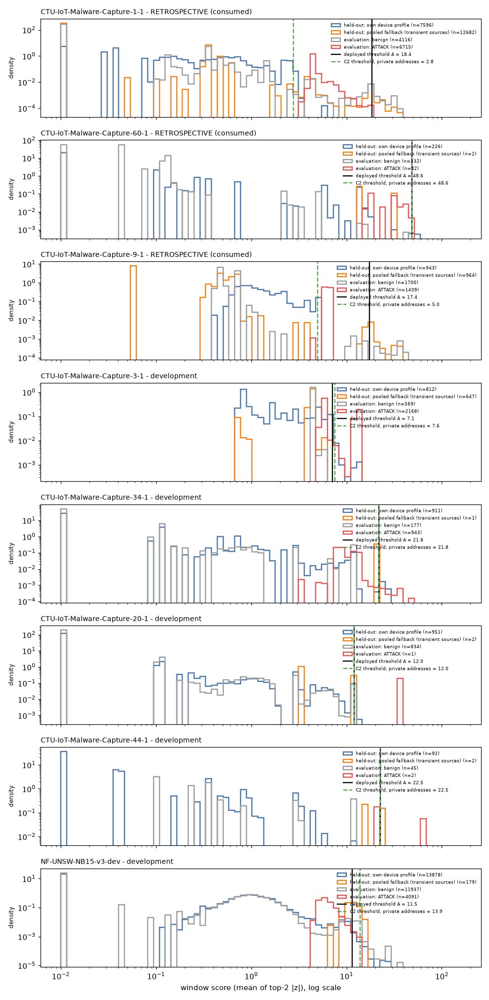

# Phase 8c root-cause report: why the deployed detector found 0 of 4 attackers in Phase 8b

## Rules followed

- Retrospective use of the consumed Phase 8b captures (1-1, 60-1, 9-1) is labelled as such and
  served only to explain. Every choice was made on development data.
- No frozen result was changed. No detection policy was deployed. The only product change is
  a diagnostic warning that does not alter any decision.

Scripts (all in `scripts/phase8c/`) and outputs (in `reports/phase8c/`):

| script | output |
|---|---|
| `trace.py` | `trace.json` |
| `tail_composition.py` | `tail_composition.json` |
| `policies.py` | `policies.json` |
| `lgbm_audit.py` | `lgbm_audit.json` |
| `plots.py` | `figures/score_distributions.png` |
| `diagnostic_check.py` | `diagnostic_check.json` |

## 1. Where attacks stop producing positive decisions

Pipeline stages, checked in order:

| stage | result |
|---|---|
| flow extraction, streaming windows | correct: no late or lost records; offline == streaming (P8-H6 on 5.4M records, integration tests). 60-1 had 24 force-closed windows at the buffer cap, but none of their records arrived late (no evidence lost) |
| window features | correct, and strongly separating: a single raw feature (`log_flows`) ranks attack windows at PR-AUC 1.00 on 1-1 and 9-1 |
| device baselines / z-scores | the infected device is scored against its own profile and ranks above benign windows (deployed PR-AUC 0.92-0.95) |
| **threshold** | **this is where it fails.** The single device-level threshold sits above every attack window: 1-1: 18.4 vs attack maximum 17.7; 9-1: 17.4 vs 6.7; 60-1: 48.6 vs 47.0 |
| threat policy, alerts, incidents | downstream of the threshold: no anomalous attack window, so no alert and no attack incident (B6) |

## 2. Why the threshold is too high

**Main cause: mixing populations under one threshold.**
- A "device" is any originating address. When a monitored device is exposed to the Internet,
  every scanner or peer that contacts it becomes a transient "device" with a few windows.
  - 1-1: 11,968 of 11,972 calibration "devices" are external.
  - 9-1: 917 of 919.
- These sources have no own profile and are scored against the pooled fallback. They do not
  resemble it, so their scores are heavy-tailed.
- The conformal threshold is the 99th percentile of **all** held-out windows. On 1-1 and 9-1,
  **100% of the windows above it come from such fallback-scored sources**.
- The marginal 1% false-alert budget is honoured, but it is spent entirely on strangers. A
  local device would need to exceed the strangers' tail to alert.

On development data this mixture is rare: the attacker owns the tail (3-1: 0% fallback) or
there are almost no external sources. That is why the deployed detector found 9/10
development attackers and the problem went unnoticed.

**Contributing causes:**
- **Uninformative own baseline (1-1).** The infected device's *benign-labelled* calibration
  flows already look like scanning: 97% unanswered, 97% new destinations, about 33
  destinations per window. Its attack windows deviate only moderately (|z| about 4.5). Two
  explanations fit: the dataset's labelling of the infected host's traffic, or infection
  activity in the calibration half.
- **Per-device normalisation.** Robust z measures deviation from the device's own past. In
  9-1, flows per window rise from about 8 to about 2,900, but the device's own variability
  scales this to |z| about 6. Absolute volume, which separates perfectly, is partly
  normalised away.
- **Insufficient calibration (60-1).** 228 held-out windows from 3 devices put the threshold
  at the sample maximum. The existing reliability diagnostic flagged it (`reliable = False`).
  In addition, the attacker's windows have the same median features as its benign windows
  (1 UDP flow per window), a genuine feature limitation.
- **Top-2 aggregation** is not a cause. Top-1, top-3 and mean |z| gave the same or fewer
  detections (policies D1/D3/Dall).

## 3. Defect or limitation?

- **No implementation (coding) defect was found.** The code does what its documentation
  states, and the decision trace reproduces the stored held-out scores exactly.
- **There is a design defect** in entity definition (originator = device) and threshold
  pooling across populations with different score distributions.
  - It is correctable in principle: separate thresholds per population (Mondrian), or
    restricting device profiles to local addresses.
  - Retrospectively, an address-class Mondrian threshold (C2) recovers 3 of 4 attackers at
    FPR <= 1.6%.
- **There are also genuine statistical limitations:** too little calibration data (60-1), a
  contaminated or scan-like own baseline (1-1), and features that do not separate per window
  (60-1).

## 4. Operating-point comparison on development data

The rule and the false-alert budget were fixed before running (DEVELOPMENT_LOG section 2).

| policy | attackers detected (dev) | max FPR | median / max false alerts/h | mean PR-AUC | within budget |
|---|---|---|---|---|---|
| A deployed | 9/10 | 0.111 | 0.0 / 50.9 | 0.833 | no |
| B per-device threshold | 5/10 | 0.111 | 0.0 / 50.9 | 0.795 | no |
| C Mondrian own/pooled | 5/10 | 0.111 | 0.0 / 50.9 | 0.795 | no |
| C2 Mondrian address class | 9/10 | 0.111 | 0.0 / 50.9 | 0.798 | no |
| D1 / D3 / Dall aggregation | 9-10/10 | 0.111-0.125 | 0.0 / 51-65 | 0.79-0.87 | no |
| E LightGBM, local threshold | 10/10 | 0.286 | 1.9 / 36.9 | 0.891 | no |
| F_or (C or E) | 10/10 | 0.286 | 2.2 / 57.2 | 0.924 | no |
| F_and (C and E) | 5/10 | 0.024 | 0.0 / 3.6 | 0.828 | **yes** |

- **The deployed policy itself exceeds the budget on development data.**
  - CTU-Normal-21: a 9-minute evaluation with 8 false alerts, 51/h; a short-history artifact.
  - NF-UNSW: FPR 3.4%.
  - Every robust policy shares these two violations.
- **E (LightGBM) exceeds the budget on several benign CTU captures:** up to 29% FPR,
  37 false alerts/h. Detecting every attacker came with unacceptable false alerts.
- **The rule selects F_and**, the only policy within budget. But it detects only 5/10
  development attackers. It is *not* recommended for deployment; it is the most conservative
  candidate.
- **Development data cannot validate the fix for the Phase 8b failure mode**, because that
  mode (local attacker + many transient external sources) barely occurs there.
  - C2 equals A on development data (9/10) and only differs where the mode occurs.
  - Its retrospective 3/4 on consumed captures is an explanation, not evidence.

Retrospective, for explanation only (consumed captures):

| | A | C | C2 | E | F_or | F_and |
|---|---|---|---|---|---|---|
| attackers detected | 0/4 | 2/4 | 3/4 | 4/4 | 4/4 | 2/4 |
| max FPR | 1.5% | 1.6% | 1.6% | 1.3% | 1.3% | 0% |

## 5. Why LightGBM looks better (and why that is weaker evidence than it seemed)

- **Most influential features** (mean |SHAP|): `new_dst_frac`, `no_reply_frac`,
  `udp_share`, `upload_share`. That is the signature of high-volume scanning to new
  destinations.
- **A single feature matches or beats it.**
  - `log_flows` alone ranks 1-1, 9-1 and 3-1 at PR-AUC 1.00, using the best sign chosen on
    the same data (an upper bound).
  - `new_dst_frac` alone gives 0.998 on NF-UNSW, where LightGBM gives 0.765.
- **Topology control:** restricted to private source addresses, 1-1 stays at 1.00. The
  advantage is not only "external vs local host".
- **Ablation:** removing the top-3 features costs 0.03-0.23 PR-AUC on development captures
  and nothing on 1-1/9-1 (redundant volume features).
- **Cross-dataset:**
  - trained on IoT-23 + CTU only: NF-UNSW PR-AUC 0.765;
  - trained on UNSW + CTU only: IoT-23 3-1 1.00, 34-1 0.87.
- **Calibration stability:** the transferred threshold gave 0-5.5% FPR on fresh captures
  (B5 mixed) and up to 29% on benign development captures.

**Interpretation.**
- The IoT-23 attacks and the NF-UNSW attacks in our data are dominated by volumetric scanning
  that an absolute-volume rule detects.
- LightGBM's "cross-family" success inside IoT-23 shows that it learns this recurring
  signature. It does **not** show cross-network or cross-attack-type generalisation.
- The safe supervised-threat policy (`unverified` by default) stays.

## 6. Decision

Supported: **conclusion 2, "the scoring method is useful but the threshold-selection
procedure is inadequate"**, together with genuine statistical limitations in specific
captures.

- The anomaly scores rank attacks well. The failure sits in the threshold: one pooled
  quantile set by transient fallback-scored sources, plus insufficient calibration in 60-1.
- Not conclusion 1: no coding defect.
- Not conclusion 3: the scores separate attacks; the decision rule does not use them well.
- Whether a corrected threshold policy works is **still inconclusive**:
  - the candidate (C2) is equivalent to A on development data;
  - it looks right only retrospectively;
  - the deployed policy and every alternative except an AND-fusion breach the false-alert
    budget on some development capture.

## 7. What was changed

- **Product (diagnostic only):** calibration now records, per level, `tail_fallback_share`
  (the share of held-out windows above the threshold that were scored against the pooled
  fallback). It warns the operator when this exceeds 50%.
  - It fires on 1-1, 9-1 and NF-UNSW. It does not fire on 3-1, 34-1 or 20-1.
  - It also fires on development 44-1, from a single tail window (a known false warning on
    tiny tails).
  - Tests: `tests/unit/test_threshold_tail_diagnostic.py`.
- **Not changed:** thresholds, scores, verdicts, threat policy.

## 8. What reliable detection would require

1. A threshold policy chosen on development data that *contains* the failure mode. Options:
   more development captures with exposed devices, or semi-synthetic mixtures of existing
   development captures. It must then be tested on independent data
   ([EXTERNAL_VALIDATION_PLAN.md](EXTERNAL_VALIDATION_PLAN.md), hypothesis X2).
2. Calibration-length requirements: refuse to alert when the threshold is unreliable (60-1),
   instead of only warning.
3. Evidence beyond scanning: ToN_IoT includes non-scanning attack types (X4 tests whether
   LightGBM adds anything beyond the scan signature).
4. An explicit, operator-visible false-alert budget per entity class, because the marginal 1%
   can be spent entirely on one class.
