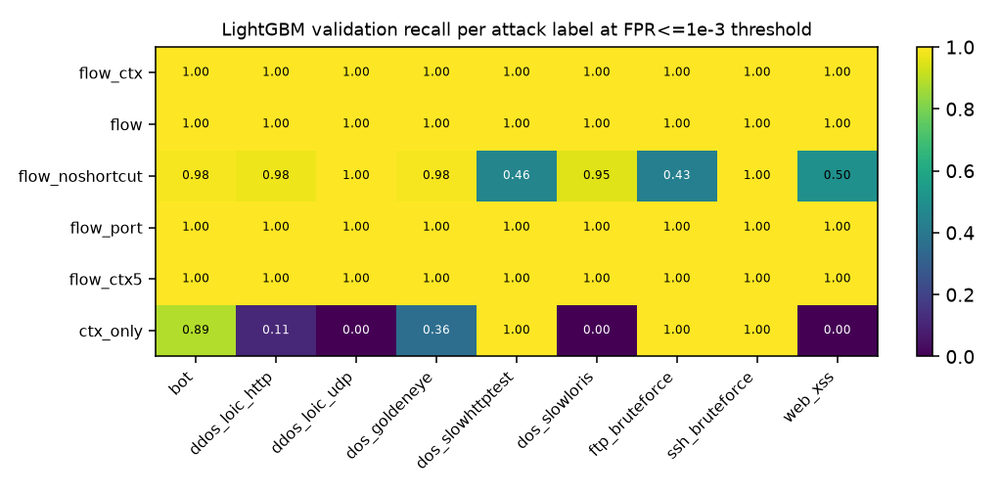
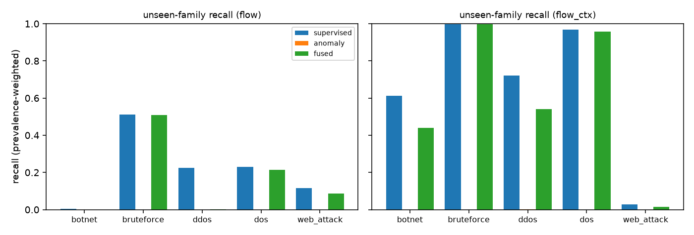

# Results v1 (validation split, measured)

All numbers: VALIDATION split, CSE-CIC-IDS2018 stratified sample (benign 50k/day, attacks capped 25k per label-day), prevalence-weighted, infiltration excluded, label cleaning v1. Generated by `scripts/aggregate_results.py`; each row names its run directory.

## E1 - binary detection by model and feature set (episode split)

| run | model | features | split | PR-AUC | ROC-AUC | recall@FPR1e-3 | recall@FPR1e-2 | precision@thr | recall@thr | ECE | fit s | peak MB |
|---|---|---|---|---|---|---|---|---|---|---|---|---|
| 20261019-125115_baseline_binary_ctx_only_lightgbm | lightgbm | ctx_only | episode | 0.9780 | 0.9981 | 0.6068 | 0.9700 | 0.9823 | 0.6068 | 0.0089 | 10.4233 | 1230.4000 |
| 20261019-125109_baseline_binary_ctx_only_logreg | logreg | ctx_only | episode | 0.8654 | 0.9784 | 0.2181 | 0.8168 | 0.9537 | 0.2181 | 0.1653 | 5.4480 | 1230.4000 |
| 20261019-124425_baseline_binary_dummy | dummy | flow | episode | 0.0837 | 0.5000 | 0.0000 | 0.0000 | 0.0000 | 0.0000 | - | 0.0762 | 1607.0000 |
| 20261019-124552_baseline_binary_hist_gb | hist_gb | flow | episode | 1.0000 | 1.0000 | 0.9999 | 1.0000 | 0.9893 | 0.9999 | 0.0003 | 25.1787 | 1920.4000 |
| 20261019-124619_baseline_binary_lightgbm | lightgbm | flow | episode | 1.0000 | 1.0000 | 1.0000 | 1.0000 | 0.9892 | 1.0000 | 0.0002 | 15.7472 | 1920.4000 |
| 20261019-124425_baseline_binary_logreg | logreg | flow | episode | 0.8156 | 0.9875 | 0.0006 | 0.6863 | 0.0517 | 0.0006 | 0.0515 | 30.2854 | 1920.4000 |
| 20261019-124457_baseline_binary_random_forest | random_forest | flow | episode | 0.9999 | 1.0000 | 0.9990 | 1.0000 | 0.9892 | 0.9990 | 0.0048 | 53.7296 | 1920.4000 |
| 20261019-125018_baseline_binary_flow_ctx_lightgbm | lightgbm | flow_ctx | episode | 1.0000 | 1.0000 | 1.0000 | 1.0000 | 0.9897 | 1.0000 | 0.0000 | 19.3574 | 2743.6000 |
| 20261019-125000_baseline_binary_flow_ctx_logreg | logreg | flow_ctx | episode | 0.9895 | 0.9992 | 0.6893 | 0.9992 | 0.9847 | 0.6893 | 0.0136 | 16.0490 | 2743.6000 |
| 20261019-124925_baseline_binary_flow_ctx5_lightgbm | lightgbm | flow_ctx5 | episode | 1.0000 | 1.0000 | 1.0000 | 1.0000 | 0.9894 | 1.0000 | 0.0003 | 17.9284 | 2176.9000 |
| 20261019-124908_baseline_binary_flow_ctx5_logreg | logreg | flow_ctx5 | episode | 0.9802 | 0.9987 | 0.6438 | 0.9941 | 0.9836 | 0.6438 | 0.0218 | 16.0435 | 2176.9000 |
| 20261019-124729_baseline_binary_flow_noshortcut_lightgbm | lightgbm | flow_noshortcut | episode | 0.9969 | 0.9997 | 0.8742 | 0.9992 | 0.9927 | 0.8742 | 0.0102 | 17.1073 | 1862.8000 |
| 20261019-124651_baseline_binary_flow_noshortcut_logreg | logreg | flow_noshortcut | episode | 0.7710 | 0.9798 | 0.0228 | 0.6476 | 0.6777 | 0.0228 | 0.0896 | 37.4391 | 1862.8000 |
| 20261019-124835_baseline_binary_flow_port_lightgbm | lightgbm | flow_port | episode | 1.0000 | 1.0000 | 1.0000 | 1.0000 | 0.9892 | 1.0000 | 0.0000 | 15.2002 | 1999.3000 |
| 20261019-124802_baseline_binary_flow_port_logreg | logreg | flow_port | episode | 0.8202 | 0.9879 | 0.0006 | 0.6825 | 0.0538 | 0.0006 | 0.0539 | 31.6676 | 1999.3000 |

## H5 - split protocol vs reported performance (LightGBM)

| run | model | features | split | PR-AUC | ROC-AUC | recall@FPR1e-3 | recall@FPR1e-2 | precision@thr | recall@thr | ECE | fit s | peak MB |
|---|---|---|---|---|---|---|---|---|---|---|---|---|
| 20261019-125249_h5_blocked_flow_lightgbm | lightgbm | flow | blocked | 0.7891 | 0.9006 | 0.3350 | 0.3753 | 0.9935 | 0.3350 | 0.1985 | 14.5341 | 1621.8000 |
| 20261019-124619_baseline_binary_lightgbm | lightgbm | flow | episode | 1.0000 | 1.0000 | 1.0000 | 1.0000 | 0.9892 | 1.0000 | 0.0002 | 15.7472 | 1920.4000 |
| 20261019-125141_h5_random_flow_lightgbm | lightgbm | flow | random | 1.0000 | 1.0000 | 1.0000 | 1.0000 | 0.9950 | 1.0000 | 0.0000 | 15.0670 | 1586.1000 |
| 20261019-125321_h5_blocked_flow_ctx_lightgbm | lightgbm | flow_ctx | blocked | 0.9913 | 0.9952 | 0.9497 | 0.9585 | 0.9976 | 0.9497 | 0.1004 | 18.7587 | 1960.1000 |
| 20261019-125018_baseline_binary_flow_ctx_lightgbm | lightgbm | flow_ctx | episode | 1.0000 | 1.0000 | 1.0000 | 1.0000 | 0.9897 | 1.0000 | 0.0000 | 19.3574 | 2743.6000 |
| 20261019-125212_h5_random_flow_ctx_lightgbm | lightgbm | flow_ctx | random | 1.0000 | 1.0000 | 1.0000 | 1.0000 | 0.9948 | 1.0000 | 0.0000 | 19.5943 | 1650.0000 |

## E5 - attack-type classification (LightGBM, episode split)

| run | task | features | macro-F1 | weighted-F1 | balanced acc |
|---|---|---|---|---|---|
| 20261019-125356_multiclass_label_flow_lightgbm | label | flow | 0.9736 | 0.9998 | 0.9980 |
| 20261019-125645_multiclass_label_flow_ctx_lightgbm | label | flow_ctx | 0.9656 | 0.9999 | 0.9476 |
| 20261019-125958_multiclass_family_flow_lightgbm | family | flow | 0.8870 | 0.9967 | 0.9463 |
| 20261019-130130_multiclass_family_flow_ctx_lightgbm | family | flow_ctx | 0.9829 | 1.0000 | 0.9933 |

Per-class (label, flow, `20261019-125356_multiclass_label_flow_lightgbm`):

| class | precision | recall | F1 | val rows |
|---|---|---|---|---|
| benign | 1.0000 | 0.9997 | 0.9999 | 63693 |
| bot | 0.9995 | 1.0000 | 0.9998 | 3768 |
| ddos_hoic | 0.0000 | 0.0000 | 0.0000 | 0 |
| ddos_loic_http | 0.9998 | 1.0000 | 0.9999 | 3071 |
| ddos_loic_udp | 1.0000 | 1.0000 | 1.0000 | 84 |
| dos_goldeneye | 1.0000 | 0.9992 | 0.9996 | 3903 |
| dos_hulk | 0.0000 | 0.0000 | 0.0000 | 0 |
| dos_slowloris | 0.7447 | 1.0000 | 0.8536 | 860 |
| port21_failed_conn | 0.9997 | 1.0000 | 0.9999 | 5178 |
| ssh_bruteforce | 1.0000 | 1.0000 | 1.0000 | 3672 |
| web_bruteforce | 0.0000 | 0.0000 | 0.0000 | 0 |
| web_sql_injection | 0.0000 | 0.0000 | 0.0000 | 0 |
| web_xss | 0.8474 | 0.9828 | 0.9100 | 174 |

Per-class (label, flow_ctx, `20261019-125645_multiclass_label_flow_ctx_lightgbm`):

| class | precision | recall | F1 | val rows |
|---|---|---|---|---|
| benign | 1.0000 | 0.9999 | 0.9999 | 63693 |
| bot | 1.0000 | 1.0000 | 1.0000 | 3768 |
| ddos_hoic | 0.0000 | 0.0000 | 0.0000 | 0 |
| ddos_loic_http | 0.9979 | 1.0000 | 0.9990 | 3071 |
| ddos_loic_udp | 1.0000 | 1.0000 | 1.0000 | 84 |
| dos_goldeneye | 1.0000 | 1.0000 | 1.0000 | 3903 |
| dos_hulk | 0.0000 | 0.0000 | 0.0000 | 0 |
| dos_slowloris | 1.0000 | 1.0000 | 1.0000 | 860 |
| port21_failed_conn | 1.0000 | 1.0000 | 1.0000 | 5178 |
| ssh_bruteforce | 1.0000 | 1.0000 | 1.0000 | 3672 |
| web_bruteforce | 0.0000 | 0.0000 | 0.0000 | 0 |
| web_sql_injection | 0.0000 | 0.0000 | 0.0000 | 0 |
| web_xss | 1.0000 | 0.5287 | 0.6917 | 174 |

Per-class (family, flow, `20261019-125958_multiclass_family_flow_lightgbm`):

| class | precision | recall | F1 | val rows |
|---|---|---|---|---|
| benign | 1.0000 | 0.9997 | 0.9999 | 63693 |
| botnet | 0.9995 | 1.0000 | 0.9998 | 3768 |
| bruteforce | 0.9251 | 0.9599 | 0.9422 | 7359 |
| ddos | 1.0000 | 1.0000 | 1.0000 | 3155 |
| dos | 0.8169 | 0.7242 | 0.7678 | 6254 |
| web_attack | 0.4422 | 0.9943 | 0.6122 | 174 |

Per-class (family, flow_ctx, `20261019-130130_multiclass_family_flow_ctx_lightgbm`):

| class | precision | recall | F1 | val rows |
|---|---|---|---|---|
| benign | 1.0000 | 1.0000 | 1.0000 | 63693 |
| botnet | 1.0000 | 1.0000 | 1.0000 | 3768 |
| bruteforce | 1.0000 | 1.0000 | 1.0000 | 7359 |
| ddos | 1.0000 | 1.0000 | 1.0000 | 3155 |
| dos | 0.9987 | 1.0000 | 0.9994 | 6254 |
| web_attack | 0.8443 | 0.9598 | 0.8983 | 174 |

## E3 / H2 - anomaly detection, global vs service-conditioned

Detectors fit on benign train flows only; score = benign-tail percentile.

| run | variant | features | PR-AUC | ROC-AUC | recall@FPR1e-2 | recall@FPR1e-3 | contexts | fit s |
|---|---|---|---|---|---|---|---|---|
| 20261019-130317_anomaly_flow_iforest_cond | iforest_cond | flow | 0.2435 | 0.8172 | 0.0768 | 0.0000 | 5.0000 | 4.3558 |
| 20261019-130313_anomaly_flow_iforest_global | iforest_global | flow | 0.1953 | 0.7974 | 0.0014 | 0.0000 | 0.0000 | 1.5936 |
| 20261019-130311_anomaly_flow_robust_z_cond | robust_z_cond | flow | 0.1141 | 0.6231 | 0.0000 | 0.0000 | 5.0000 | 1.3046 |
| 20261019-130309_anomaly_flow_robust_z_global | robust_z_global | flow | 0.2580 | 0.6265 | 0.1830 | 0.0005 | 0.0000 | 0.7048 |
| 20261019-130345_anomaly_flow_ctx_iforest_cond | iforest_cond | flow_ctx | 0.3758 | 0.8451 | 0.0758 | 0.0758 | 5.0000 | 4.5636 |
| 20261019-130341_anomaly_flow_ctx_iforest_global | iforest_global | flow_ctx | 0.3254 | 0.8637 | 0.0008 | 0.0004 | 0.0000 | 1.5757 |
| 20261019-130338_anomaly_flow_ctx_robust_z_cond | robust_z_cond | flow_ctx | 0.1012 | 0.5938 | 0.0000 | 0.0000 | 5.0000 | 1.7716 |
| 20261019-130336_anomaly_flow_ctx_robust_z_global | robust_z_global | flow_ctx | 0.1551 | 0.6744 | 0.0005 | 0.0005 | 0.0000 | 1.0402 |

## E6 / H4 - unseen attack family (leave-one-family-out)

Thresholds at benign-val FPR <= 1e-3 (fusion: 5e-4 each, OR rule). Evaluated on all rows of the held-out family + benign validation.

| run | held-out family | features | rows | supervised recall | anomaly recall | fused recall | sup FPR | anom FPR | fused FPR |
|---|---|---|---|---|---|---|---|---|---|
| 20261019-130535_openset_flow_without_botnet | botnet | flow | 24494.0000 | 0.0037 | 0.0000 | 0.0000 | 0.0010 | 0.0008 | 0.0009 |
| 20261019-130407_openset_flow_without_bruteforce | bruteforce | flow | 43364.0000 | 0.5118 | 0.0000 | 0.5082 | 0.0010 | 0.0008 | 0.0009 |
| 20261019-130453_openset_flow_without_ddos | ddos | flow | 38041.0000 | 0.2259 | 0.0000 | 0.0006 | 0.0010 | 0.0008 | 0.0009 |
| 20261019-130430_openset_flow_without_dos | dos | flow | 67355.0000 | 0.2291 | 0.0000 | 0.2144 | 0.0010 | 0.0008 | 0.0009 |
| 20261019-130515_openset_flow_without_web_attack | web_attack | flow | 709.0000 | 0.1171 | 0.0000 | 0.0860 | 0.0010 | 0.0008 | 0.0010 |
| 20261019-130802_openset_flow_ctx_without_botnet | botnet | flow_ctx | 24494.0000 | 0.6127 | 0.0000 | 0.4401 | 0.0010 | 0.0009 | 0.0009 |
| 20261019-130610_openset_flow_ctx_without_bruteforce | bruteforce | flow_ctx | 43364.0000 | 0.9983 | 0.0000 | 0.9971 | 0.0010 | 0.0009 | 0.0009 |
| 20261019-130708_openset_flow_ctx_without_ddos | ddos | flow_ctx | 38041.0000 | 0.7221 | 0.0009 | 0.5416 | 0.0010 | 0.0009 | 0.0009 |
| 20261019-130639_openset_flow_ctx_without_dos | dos | flow_ctx | 67355.0000 | 0.9678 | 0.0000 | 0.9573 | 0.0010 | 0.0009 | 0.0009 |
| 20261019-130735_openset_flow_ctx_without_web_attack | web_attack | flow_ctx | 709.0000 | 0.0268 | 0.0000 | 0.0155 | 0.0010 | 0.0009 | 0.0009 |

